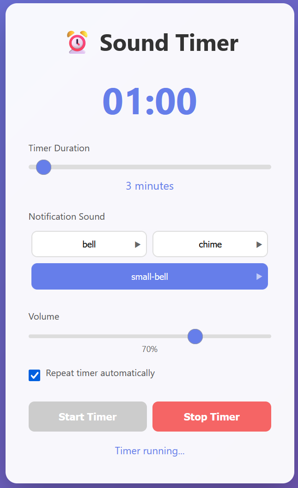

# Sound Timer Application

A web-based timer application with custom sound notifications that automatically detects and loads audio files from a designated folder.

<p align="center">
  
</p>

## Features

- **Custom Sound Files**: Use your own audio files for notifications
- **Auto-Detection**: Automatically detects new sounds added to the folder
- **Real-time Updates**: Interface updates immediately when sounds are added/removed
- **Multiple Formats**: Supports MP3, WAV, OGG, M4A, and WebM audio formats
- **Volume Control**: Adjustable volume for notification sounds
- **Timer Duration**: Set timer from 1 to 60 minutes
- **Auto-Repeat**: Option to automatically restart the timer
- **Sound Preview**: Click any sound to preview it

## Quick Start

### Prerequisites
- Docker and Docker Compose installed
- Audio files in MP3, WAV, OGG, M4A, or WebM format

### Setup Instructions

1. **Create project directory:**
   ```bash
   git clone https://github.com/w4hf/Sound-Timer.git
   cd sound-timer
   ```

2. **Add your audio files:**

   ```bash
   mkdir ./sounds

   # Copy your notification sounds to the sounds folder (examples)
   cp ~/Downloads/notification-sounds/*.mp3 ./sounds/
   cp ~/Music/bells/*.wav ./sounds/

   # Or download some free sounds (examples)
   cd sounds
   wget -O bell.mp3 https://www.soundjay.com/misc/sounds/bell-ringing-05.mp3
   wget -O small-bell.mp3 https://www.soundjay.com/misc/small-bell-ringing-01.mp3
   wget -O chime.mp3 https://www.soundjay.com/misc/magic-chime-06.mp3
   cd ..
   ```

3. **Build and run**

    Option 1 : Build and run with Docker Compose:
   ```bash
   docker-compose up -d --build
   ```

    Option 2 : Build and run with Docker command:
   ```bash
   docker build -t sound-timer .
   docker run -d -p 3000:3000 -v ./sounds:/app/sounds:ro --name sound-timer sound-timer
   ```


4. **Access the application:**
   Open your browser and navigate to: `http://localhost:3000`

## Directory Structure

```
sound-timer-app/
├── server.js           # Node.js backend server
├── package.json        # Node.js dependencies
├── Dockerfile          # Docker configuration
├── docker-compose.yml  # Docker Compose configuration
├── .dockerignore      # Docker ignore file
├── public/
│   └── index.html     # Frontend application
└── sounds/            # Place your audio files here
    ├── bell.mp3
    ├── chime.wav
    └── gong.ogg
```

## Managing Sound Files

### Adding New Sounds
Simply copy audio files to the `sounds/` directory:
```bash
cp new-sound.mp3 ./sounds/
```
The application will automatically detect and display the new sound.

### Removing Sounds
Delete files from the `sounds/` directory:
```bash
rm ./sounds/old-sound.mp3
```
The interface will update immediately.

### Supported Audio Formats
- MP3 (.mp3)
- WAV (.wav)
- OGG (.ogg)
- M4A (.m4a)
- WebM (.webm)

### Naming Convention
- File names become sound labels in the interface
- Use descriptive names: `gentle-bell.mp3`, `soft-chime.wav`
- Avoid special characters in file names

## Docker Commands

### Start the application:
```bash
docker-compose up -d
```

### Stop the application:
```bash
docker-compose down
```

### View logs:
```bash
docker-compose logs -f
```

### Rebuild after changes:
```bash
docker-compose up -d --build
```

### Access container shell:
```bash
docker exec -it sound-timer sh
```

## Customization

### Change Port
Edit `docker-compose.yml`:
```yaml
ports:
  - "8080:3000"  # Change 8080 to your desired port
```

### Persist Sounds Between Rebuilds
The `sounds/` directory is mounted as a volume, so files persist even when the container is rebuilt.

## Troubleshooting

### No sounds appearing
1. Check that audio files are in the correct format
2. Verify files are in the `sounds/` directory
3. Check container logs: `docker-compose logs`

### Connection issues
1. Ensure port 3000 is not in use
2. Check firewall settings
3. Verify Docker is running

### Audio won't play
1. Check browser permissions for audio playback
2. Verify file format is supported by your browser
3. Try a different audio file format

## Development

### Run locally without Docker:
```bash
npm install
# Add audio files to sounds/
npm start
```

### Development mode with auto-reload:
```bash
npm run dev
```

## License

MIT